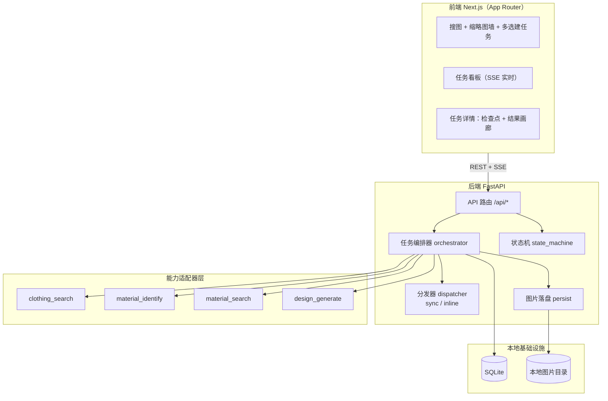
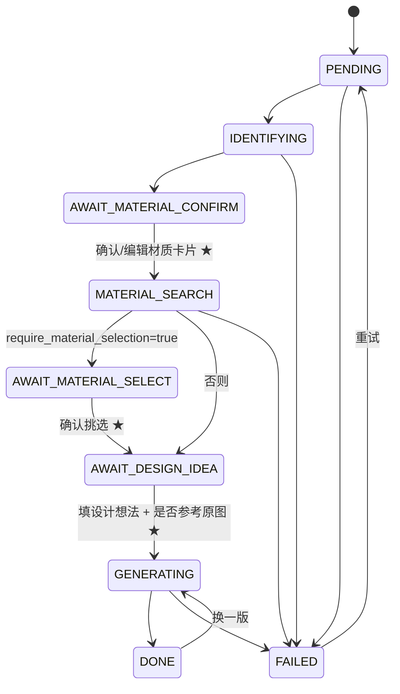

# AI 服装辅助设计（MVP）

一条「**搜图 → 选图建任务 → 视觉识别 → 素材检索 → 图生图**」的多阶段 AI 流水线，辅助服装设计工作。

本仓库是**可运行的 MVP Demo**：四个 AI 能力均已接入**真实 API**（Unsplash 图库 + OpenAI 兼容端点），
在设置页配置端点与密钥即可跑通全链路；新增一家服务只需加一个**适配器**，架构与前端无需改动。

---

## 1. 四个能力（abilities）

| 能力 | 签名 | 当前实现 |
|---|---|---|
| 搜索服装图 | `searchClothingImages :: [网站列表] -> [服装图片列表]` | `UnsplashClothingSearchProvider` |
| 识别服装材质 | `identifyClothingMaterial :: 服装图片 -> 材质卡片` | `OpenAICompatibleVLMIdentifier` |
| 查找材质图 | `searchMaterialImages :: [检索条件] -> [面料参考图列表]` | `UnsplashMaterialSearchProvider` |
| 图生图生成设计图 | `generateDesignImage :: ([面料图], 设计想法, 材质摘要) -> [设计图]` | `OpenAICompatibleImageGenerator` / `ComfyUIImageGenerator` |

四个能力的契约定义在 `backend/app/abilities/base.py`，实现通过 `registry.register_provider()` **热插拔**。

---

## 2. 架构



**任务驱动**：每张被选中的服装图 = 一个任务（`Task`），N 张图并发执行 N 条流水线，互不阻塞。

---

## 3. 流水线与人工检查点



三个**人工检查点**是产品成败关键（设计方案 §3）：材质识别错误会导致后续全错，
用户花 3 秒确认卡片可大幅提升最终满意度。检查点 1 支持**改卡片重跑后续步骤**。

---

## 4. 目录结构

```
cloth-image/
├─ scripts/                    # 本地启停/构建脚本（setup / dev / build / start / test）
├─ .env.example                # 全部环境变量与默认值
├─ AI服装辅助设计方案.md         # 原始设计方案
├─ backend/
│  ├─ pyproject.toml
│  ├─ alembic/                 # 数据库迁移（含初始表结构）
│  └─ app/
│     ├─ main.py               # FastAPI 入口（CORS / 路由 / lifespan）
│     ├─ config.py             # pydantic-settings 配置
│     ├─ enums.py              # TaskStatus / MaterialSource / MaterialImageOrigin
│     ├─ schemas.py            # API 契约（与前端 types.ts 对应）
│     ├─ storage.py            # 本地图片存储（目录 + /media URL）
│     ├─ db/                   # SQLAlchemy 模型与会话
│     ├─ ability_config.py     # ★ 能力配置（设置页写入，DB 为唯一来源，不读 env）
│     ├─ abilities/            # ★ 能力适配器层
│     │  ├─ base.py            #   4 个 Protocol + DTO
│     │  ├─ http.py            #   共享 HTTP 客户端（超时 / 重试 / 具名异常）
│     │  ├─ image_ops.py       #   缩放、缩略图、data URL 编码
│     │  ├─ prompting.py       #   图生图 prompt 组装
│     │  ├─ registry.py        #   按能力注入实现（provider 工厂表）
│     │  ├─ unsplash_client.py #   Unsplash 共享客户端（鉴权 / 分页 / 归一化）
│     │  ├─ clothing_search/unsplash.py
│     │  ├─ material_identify/openai_compatible_vlm.py
│     │  ├─ material_search/unsplash.py
│     │  └─ design_generate/openai_compatible_image.py
│     ├─ taxonomy/materials.yaml  # 受控材质词表（60 条，中英双语）
│     ├─ tasks/                # 状态机 / 编排器 / 分发器 / 持久化 / 序列化 / fetch(下载+镜像)
│     ├─ auth/                 # ★ 登录 + 许可查询（entitlement-api-new 客户端 / JWT 验签 / 路由）
│     ├─ tools/probe.py        # 真实 provider 联调探针
│     └─ api/                  # search / tasks / events(SSE) / taxonomy / media
│  └─ tests/                   # 能力契约 / 状态机 / 端到端 / 适配器 / fakes（测试用假实现）
└─ frontend/
   └─ src/
      ├─ app/page.tsx          # 搜图 + 缩略图墙 + 多选建任务
      ├─ app/tasks/page.tsx    # 任务看板（SSE）
      ├─ app/tasks/[id]/page.tsx  # 任务详情（检查点 + 结果画廊）
      ├─ app/login/page.tsx    # 邮箱验证码登录 + 许可状态
      ├─ components/           # Pipeline / SelectableImageGrid / MaterialCardEditor / ResultGallery
      └─ lib/                  # api / auth / types / hooks / taskStatus
```

---

## 5. 快速开始

### 一键脚本（Windows PowerShell）

```powershell
.\scripts\setup.ps1   # 安装依赖（后端 venv + 前端 npm）并建库
.\scripts\dev.ps1     # 启动后端 :8000（热重载）+ 前端 :3000
```

- 前端 http://localhost:3000
- 后端 API 文档 http://localhost:8000/docs

其它脚本：

| 脚本 | 作用 |
|---|---|
| `.\scripts\build.ps1` | 构建前端生产产物 + 后端预编译 + 类型检查 |
| `.\scripts\start.ps1` | 生产启动（需先 build） |
| `.\scripts\test.ps1` | 后端 pytest + 前端类型检查 |

> 注意：`dev` 与 `build`/`start` 不要同时使用 —— `npm run dev` 会重写 `.next`，使生产构建失效。
> 生产启动顺序：`build.ps1`（先停掉 dev）→ `start.ps1`。

### 手动步骤（等价）

后端：

```bash
cd backend
python -m venv .venv
.venv\Scripts\activate                                  # Windows（macOS/Linux: source .venv/bin/activate）
pip install -e ".[dev]"
uvicorn app.main:app --reload --port 8000                 # 首次启动会自动建表（SQLite）
```

前端：

```bash
cd frontend
npm install
npm run dev          # 默认连 http://localhost:8000
```

默认使用 **SQLite + 本地目录 + 进程内线程池**，无需任何外部服务（不需要 Docker / Postgres / Redis / MinIO）。
如前端要指向别的后端地址，先设 `NEXT_PUBLIC_API_BASE_URL` 再启动。

---

## 6. 配置

**能力配置**（provider / 端点 / Key / 模型）只在**设置页**配置，写入数据库、立即生效，
**不读环境变量**。其余配置见 `.env.example`：

| 变量 | 默认 | 说明 |
|---|---|---|
| `IMAGE_SIZE` | `1024x1024` | 生图尺寸；**必须用 `x` 分隔**，写成 `1024*1024` 会被 API 拒绝 |
| `IMAGE_MAX_REFS` | `3` | 参考图上限；实测 `qwen-image-3.0` 只支持 0~3 张 |
| `PROMPT_EXTEND` | `false` | 是否允许模型改写提示词（已结构化组装，建议关闭） |
| `IDENTIFY_CACHE_ENABLED` | `true` | 相同图片 + 相同模型时复用识别结果 |
| `IDENTIFY_SWATCH_ENABLED` | `true` | 识别时从原图裁一块干净面料小样（swatch）作为保真锚点 |
| `IDENTIFY_SWATCH_MAX_SIDE` | `768` | 材质小样的最长边（落盘与参考注入的尺寸上限） |
| `PROVIDER_TIMEOUT_S` | `90` | 外部调用超时（秒） |
| `PROVIDER_MAX_RETRIES` | `3` | 外部调用失败重试次数 |
| `VISION_MAX_IMAGE_SIDE` | `1568` | 送模型前图片等比缩放的最长边 |
| `TASK_EXECUTION` | `inline` | `sync` 同步（测试）/ `inline` 线程池（默认） |
| `DATABASE_URL` | sqlite | 本机 SQLite |

> 上表中的项可由环境变量提供默认值、也可在设置页覆盖；**能力配置项则完全来自设置页**。

### 6.1 在界面上配置（推荐）

打开 `http://localhost:3000/settings`：

- **四个能力**各自显式选择实现，且仅当选中真实实现时才展开配置项：
  - 搜索服装图：`unsplash`（Unsplash 图库检索，只需 Access Key）
  - 查找材质图：`unsplash`（Unsplash 面料特写，按卡片里的面料名每个锚一次请求）
  - 识别：`openai_compatible`（OpenAI 兼容 `/chat/completions`）
  - 生图：`openai_compatible_image`（OpenAI 兼容 `/images/generations`）
- 调整生图参数、识别参数、流水线参数与 HTTP 超时/重试
- 查看识别缓存的命中数与估算省下的 token，并可一键清空

**配置优先级**：能力配置 = 设置页（数据库 `app_setting`）**唯一来源**；
其余项 = 设置页 > 环境变量 / `.env` > 代码默认值。
「重置为环境变量」会清空全部覆盖。

> ⚠️ 密钥**永不回传**（只返回“是否已配置”），但本服务当前没有鉴权 ——
> 能访问该页的人都可以修改配置并**写入**密钥。仅限本机 / 内网使用；
> 对外暴露前请设 `SETTINGS_WRITE_ENABLED=false`（只读查看）或先补上鉴权。

### 6.2 常见问题

- **界面报 `Failed to fetch`**：多半是后端没起来或请求打在了代理上。
  `fetch` 只有在**连接层失败**或**响应缺 CORS 头**时才报这个（而不是 500）。
  先看后端终端有没有 traceback；本机验证用 `curl.exe -s --noproxy "*" http://127.0.0.1:8000/api/health`。
- **后端日志 `no such column: ...`**：本地 `.data/app.db` 建于旧迁移之前。
  执行 `alembic upgrade head` 升级，或直接删除 `.data/app.db` 重建（已不再有启动时自愈）。

---

## 7. API

| 方法 | 路径 | 说明 |
|---|---|---|
| GET | `/api/health` | 健康检查 + 当前能力提供方 |
| GET | `/api/search/sites` | 可选网站列表 |
| POST | `/api/search/clothing` | 搜索服装图（`sites`, `query`, `count`） |
| POST | `/api/tasks` | 勾选 N 张图 → 创建 N 个任务 |
| GET | `/api/tasks` | 任务列表（看板） |
| GET | `/api/tasks/{id}` | 任务详情 |
| PUT | `/api/tasks/{id}/material-card` | 编辑材质卡片（局部更新，只写库不推进状态） |
| POST | `/api/tasks/{id}/confirm-materials` | ★检查点1：确认材质卡片 → 按卡片检索面料图（无 body） |
| POST | `/api/tasks/{id}/material-images` | 编辑入口2：上传面料图（multipart `files`，进参考图池） |
| DELETE | `/api/tasks/{id}/material-images/{image_id}` | 从参考图池移除一张面料图 |
| POST | `/api/tasks/{id}/select-materials` | ★检查点2：挑选材质图 |
| POST | `/api/tasks/{id}/generate` | ★检查点3：填设计想法（`design_idea` / `num_candidates` / `use_reference`）→ 生成设计图 |
| POST | `/api/tasks/{id}/retry` | 失败重试 |
| DELETE | `/api/tasks/{id}` | 删除任务 |
| POST | `/api/tasks/bulk-delete` | 批量删除任务（body：`{"task_ids": [...]}`，返回 `{deleted, not_found}`） |
| GET | `/api/tasks/{id}/events` | **SSE** 任务进度流（`snapshot` / `event`） |
| GET | `/api/events/stream` | **SSE** 看板任务列表流 |
| GET | `/api/material-taxonomy` | 受控材质词表（面料名 / 分类 / 光泽 / 垂坠 / 关键词） |
| GET | `/api/material-taxonomy/card-options` | 材质卡片的下拉受控取值（图案 5 类 / 光泽 4 档 / 品类 / 面料名…） |
| GET | `/api/cache/identify/stats` | 识别缓存规模 / 累计命中 / 估算省下的 token |
| DELETE | `/api/cache/identify` | 清空识别缓存（可选 `?model=` 只清某个模型） |
| GET | `/api/settings` | 能力配置：字段清单 + 取值 + 密钥状态 + 能力可用状态 |
| PUT | `/api/settings` | 部分更新配置（`{"values": {...}}`；值为 `null` 表示删除覆盖） |
| DELETE | `/api/settings` | 清空全部覆盖，回退到环境变量 / 默认值 |
| POST | `/api/auth/request-login` | 申请邮箱验证码（`{"email": ...}`，5 分钟内限一次） |
| POST | `/api/auth/verify-login` | 校验验证码 → 换取许可证 → 写 httpOnly cookie |
| GET | `/api/auth/me` | 查询当前登录状态与许可有效期（未登录 401） |
| POST | `/api/auth/logout` | 清除登录 cookie |

### 7.1 生成设计图时是否参考原服装图

`POST /api/tasks/{id}/generate` 的 `use_reference`（默认 `true`）决定**要不要把原服装图
作为参考图 1 交给生图模型**：

- `true`（默认，旧行为）：原图作为「参考图1」参与图生图，保留版型轮廓；材质图顺延为参考图 2~N
- `false`：原图**完全不参与**，只送材质图（材质图改为从参考图 1 编号），
  版型只能靠设计想法里的文字描述 —— 适合「只要材质感觉、不要原版型」的场景

细节：

- 任务上会持久化该开关（`task.use_reference`），**不传则保持任务上的已有值**
  （与 `design_idea` 同样的部分更新语义）；前端在任务详情页生成面板提供勾选框
- 每张设计图都记录 `used_reference`（`design_image.used_reference`），
  由 provider 依据**实际送出的参考图**回报 —— 外链无字节、超出参考图上限、
  或预设本身不吃参考图（如 ComfyUI `z_image_turbo`）时为 `false`，
  前端结果卡片据此打「参考原图 / 纯材质生成」
- 任务事件会写明「本次不参考原服装图…」；若最终一张参考图都没有（关掉原图且材质图无本地字节），
  会再提示「退化为纯文生图」（`qwen_image_edit` 这类编辑模型退化成文生图时效果会明显下降）

```json
POST /api/tasks/{id}/generate
{ "design_idea": "改成收腰版型", "num_candidates": 2, "use_reference": false }
```

### 7.2 材质卡片（识别与生成之间的中间层）

识别不再输出「材质 tag 列表」，而是一张**可编辑的材质卡片**（MVP 计划 §3）：

```json
{
  "category": "连衣裙",
  "regions": [{
    "region_id": "body", "region_type": "身片",
    "color":   { "dominant_hex": "#2B3A4A", "dominant_name": "深灰蓝",
                 "palette": [{"hex": "#2B3A4A", "ratio": 0.72}, ...], "distribution": "整体均匀" },
    "pattern": { "type": "纯色", "scale": "", "direction": "", "layout": "全身" },
    "optical": { "gloss": "哑光", "transparency": "不透明" },
    "fabric":  { "material": "桑蚕丝", "material_en": "Mulberry Silk", "category": "天然纤维" },
    "behavior":{ "weight": "中等", "drape": "适中", "is_default": true },
    "confidence": { "color": 0.95, "pattern": 0.91, "gloss": 0.83 }
  }],
  "note": "",
  "swatch": { "url": "...", "thumbnail_url": "...", "crop_box": [0.3, 0.4, 0.6, 0.7] }
}
```

要点：

- **A 层只做视觉属性**（颜色 / 图案 / 光泽），B 层（面料）只填受控词表里的面料名，
  C 层（手感）填默认值并标记 `is_default` —— 后续接模型时不用改 Schema
- **区域**：本期末接分割模型，`regions` 恒为单条 `body / 身片`；
  字段已预留，接模型时无需迁移
- **逐字段置信度**：低于 70% 的字段在前端标黄提示「待确认」
- **材质小样（swatch）**：由 VLM 给出「干净面料块」的归一化框，后端从原图裁一小块落盘（
  兜底：框非法时退化为图像中心区域）—— 它是生成阶段的**保真锚点**
- **三种编辑入口**：改属性（`PUT /material-card`）、换小样（上传面料图）、写文字（卡片 `note`）
- 只有**面料名**会用于检索面料图；颜色 / 图案 / 光泽作为检索增强（英文时才会拼进 query，
  因为 Unsplash 对中文命中率低）

### 7.3 识别结果缓存

同一张图 + 同一个模型 → 直接复用上次识别出的材质卡片，跳过 VLM 调用。
实测单次识别约 **1500 tokens**，而「同一张图建多个任务」是常见操作，收益直接。

- 缓存 key = `(图片内容 sha256[:32], 模型名)`；**模型名参与 key**，换模型后旧缓存自然失效
- 图片哈希在落盘时顺带算出，存在 `clothing_image.image_hash`
- 缓存的是卡片的**语义部分**（含各区域的裁剪框）；小样字节不进缓存，
  命中后由编排器拿原图按框重裁 —— 所以缓存只对「同一张图」有意义
- 命中时会在任务事件里写明「命中识别缓存…省约 N tokens」，前端执行日志可见
- 外链图未下载时算不出哈希，此时不缓存（不影响功能）
- 缓存内容损坏（如旧版本存的是 tag 列表）会自动丢弃并重新识别

### 7.4 登录与许可（entitlement-api-new）

当前只做两件事：**邮箱验证码登录**、**查询当前账号是否持有有效许可**。
**不拦截任何业务接口**，任务也不区分归属——检索 / 建任务 / 生图仍按原来的方式调用。

```
浏览器 ──fetch(credentials:include)──▶ FastAPI /api/auth/*  ──Bearer──▶ entitlement-api-new
                                          │
                                          └─ Set-Cookie: ci_license（httpOnly，许可证 JWT）
```

| 端点 | 行为 |
|---|---|
| `POST /api/auth/request-login` | 代理 `POST /auth/request-login`；6 位验证码 5 分钟有效，同一邮箱 5 分钟内只能申请一次（429） |
| `POST /api/auth/verify-login` | 代理 `POST /auth/verify-login` 拿会话令牌 → 立即 `POST /licensing/licenses/obtain` 换许可证 → 写 `ci_license` cookie；无订阅返回 403 `SUBSCRIPTION_REQUIRED` |
| `GET /api/auth/me` | **本地验签**许可证（HS256 / `aud=entitlement-client` / `exp` / `product` / `machineId`），不访问 entitlement-api |
| `POST /api/auth/logout` | 清除 cookie |

配置见 `.env.example` 的「登录 / 许可」一节，关键是：

- `ENTITLEMENT_API_BASE_URL`：entitlement-api-new 地址（它默认端口 3000 与 Next 冲突，建议起在 3001）
- `ENTITLEMENT_LICENSE_JWT_SECRET`：**与 entitlement-api-new 的 `LICENSE_JWT_SECRET` 完全一致**，只用于验签
- `ENTITLEMENT_PRODUCT_CODE` / `ENTITLEMENT_EDITION_CODE`：取许可时使用的产品与版本
- `ENTITLEMENT_MACHINE_ID`：整站共用一个激活槽（Web 端没有可信设备指纹）
- `CORS_ALLOW_ORIGINS`：带 cookie 的跨端口请求不能用 `*`，默认放行 `localhost:3000`

本地联调步骤：

1. 启动 entitlement-api-new（`pnpm dev:http`，端口改为 3001），配好 MySQL / Redis 与 `LICENSE_JWT_SECRET`。
2. 用管理员会话在 entitlement 侧注册产品 / 版本，并给测试邮箱签发订阅（见其 `docs/` 与 admin 路由）。
3. 启动本项目，打开 `/login` 走「邮箱 → 验证码」。
4. **验证码目前不会真的发邮件**：entitlement-api-new 的 `ChallengeIssued` 处理器只写日志，
   联调阶段请从它的控制台日志里取 6 位码；正式上线前需在其侧接入邮件投递。

已知取舍（当前阶段刻意不做）：

- 会话令牌只为换许可证，**用完即丢、不落库**；许可证到期（≤24h 或订阅期末）后需重新登录。
- 不强制鉴权、不做任务归属隔离、不做在线购买；后续要加时再引入 `user_session` 表与
  `require_license` 依赖即可，现有接口契约不受影响。

---

## 8. 测试

```bash
cd backend
.venv\Scripts\python.exe -m pytest -q
```

覆盖：能力契约（Protocol 一致 + 确定性）、状态机转移、端到端流水线
（含人工检查点、自动串联生成、非法操作 409、图片经 `/media` 可访问）。

---

## 9. 接入真实 API

### 9.1 按能力切换（重要）

能力**必须显式配置**：没有全局开关，也没有「留空回退」。在界面上的「能力配置」页
（推荐，立即生效且持久化）逐项选择实现即可；provider 名写错会在**构造能力时立即报错**，
启动日志还会提示端点 / Key / 模型是否缺失。

- 搜索服装图：`unsplash`（只需 Unsplash Access Key）
- 识别：`openai_compatible`
- 生图：`openai_compatible_image`
- 查找材质图：`unsplash`（可与服装图共用同一个 Access Key）

> 环境变量**不再**参与能力配置（这是刻意去掉的兼容层）。

### 9.2 已验证示例：阿里云 MaaS（OpenAI 兼容）

这是一种已验证的 OpenAI 兼容端点：同一个 base_url + 同一个 Key 同时提供视觉理解与生图能力。
在各能力的设置里**分别**填入即可（两个能力并不共享配置）。

| 能力 | 端点 | 模型 |
|---|---|---|
| 材质识别 | `POST {base}/chat/completions` | `qwen3-vl-plus` |
| 设计图生成 | `POST {base}/images/generations` | `qwen-image-3.0` |

已实测确认的行为，实现时已按此适配：

- 视觉输入用 OpenAI 标准多模态数组，`response_format={"type":"json_object"}` 可用
  （若目标端点不支持，会自动剥掉该字段重试一次）
- 生图 `size` 必须形如 `1024x1024`，用 `*` 会 400
- 生图 `image` 可传字符串或数组（多参考图），但模型限 **0~3 张**；
  超过会报 `supports 0~3 image content items`
- 生图响应 `data` 是**被转义的 JSON 字符串数组**，需逐个 `json.loads`
- 生图返回的是 **OSS 临时地址** → 编排器会下载并**镜像到自有存储**
- 外部服务**访问不到**我们的 `localhost/media` 地址 → 送模型一律用 base64 data URL

### 9.3 已验证示例：Unsplash（服装图搜索）

只需 **Access Key**（`Authorization: Client-ID <key>`）；Secret Key 仅用于 OAuth，用不到。

- 端点：`GET https://api.unsplash.com/search/photos?query=...&per_page=30&page=1`
- 返回 `results[].urls.{regular,small}`（**官方要求热链**）+ `links.html` + `user.name`，
  我们把摄影师与 Unsplash 署名写进 `title`、原图页存进 `page_url`；
  图片**只存外链、不镜像**（`persist_external`，保持热链），生图前由编排器**按需下载**一份字节再喂模型
- ⚠️ ComfyUI 只吃**上传的字节**（读不到外链）→ 靠上面的「按需下载」外链材质图才能进 ComfyUI；
  若下载失败，参考图会被丢弃，并在任务事件里提示「部分参考图未生效：…」（不再静默降级）
- 单页最多 30 条，超出会自动翻页（搜索页 `count` 上限 60）
- **不支持按站点过滤**，`sites` 被忽略；搜索页站点列表会随 provider 变为「Unsplash（不限站点）」
- demo 应用限 **50 次/小时**（响应头 `X-Ratelimit-Remaining`）；超限抛 `ProviderRateLimitError`，
  接口以 **502** 返回可读原因
- **两个能力共用**同一份客户端（`abilities/unsplash_client.py`）与同一个 Access Key：
  服装图按关键词直接搜；面料图把卡片里的面料名转成 `{material_en} fabric texture close up`
  （颜色 / 图案 / 光泽作为可选增强，但只在 ASCII 时才拼进 query）
  各搜一次（词表里没有英文名时回退 `taxonomy.build_material_query`）
- 材质图的 `similarity` 是**排名代理**（Unsplash 不返回相关性分数），仅用于排序展示
- 提示：Unsplash 以英文关键词效果最佳，中文词命中率有限

### 9.4 联调探针

```bash
cd backend
python -m app.tools.probe                  # 识别 + 生图各跑一次（真实调用，消耗额度）
python -m app.tools.probe --image x.jpg    # 指定输入图
python -m app.tools.probe --skip-image     # 只探识别
```

会打印生效的 provider、识别出的材质卡片（含小样字节数）与依据、token 用量、生图返回的 URL。

### 9.5 新增一个 provider

要再接一家 provider：

1. 在 `abilities/<能力>/` 下加适配器类（实现对应 Protocol）；
2. `settings_spec.py` 的 `ABILITY_SPECS` 把该能力的 `options` 加上新 provider 名、
   `fields` 补上需要的配置项（选中真实实现时 UI 会自动展开）；
3. `abilities/ability_config.py` 加上对应字段（形如 `{ability}_api_key`）；
4. `abilities/registry.py` 用 `register_provider()` 注册该 provider 的工厂。

UI、校验与告警（`config_warnings`）都会自动跟随 spec，无需改前端。

**各能力推荐路线**（详见 `AI服装辅助设计方案.md`）：

- **材质图检索**：MVP 复用图库搜索（query 换成 `"{材质} fabric texture close-up"`）；
  生产自建面料图库 + CLIP/SigLIP embedding + 向量库（pgvector / Qdrant）
- **识别进阶**：先用服装分割（SCHP）裁掉背景再送模型，提升街拍图准确率
- **生成进阶**：多模型对比（`qwen-image-3.0` vs `-pro`）、编辑链迭代

---

## 10. 风险与注意事项

1. **版权合规**：爬取他人服装图作为生成输入，商用有风险。优先授权图库、只存引用 URL、
   生成结果标注来源、定位为「内部设计参考」。
2. **反爬**：能用 API 就别爬；爬虫方案需代理池与验证码处理。
3. **成本**：VLM 识别约 $0.001–0.01/张，图生图约 $0.02–0.08/张，单任务全链路约 $0.05–0.15。
4. **识别准确率**：光泽类面料（真丝 vs 醋酸 vs 缎面涤纶）单图难区分，
   「逐字段置信度 + 人工确认」是必要设计，不追求全自动 100% 准确。
   卡片里的 B 层（织法）与 C 层（垂坠/厚薄）本体期未做推断，均为占位默认值。
5. **配置页无鉴权**：`/api/settings` 可以写入密钥。仅限本机 / 内网使用；
   对外部署前必须补鉴权或设 `SETTINGS_WRITE_ENABLED=false`。
   （本次接入的登录只用于查询许可，**没有**给设置页或业务接口加权限。）
6. **密钥不要写进 `.env.example`**：该文件**不在** `.gitignore` 里，会被提交；
   真实密钥只写在本地 `.env`（已忽略）。
7. **许可只是展示，不是闸门**：`/api/auth/me` 返回的许可状态目前不参与任何接口的准入判断，
   未登录 / 未订阅仍可调用全部 API。需要「按订阅限制使用」时，再按 README §7.4 的取舍补
   `require_license` 依赖。

---

## 11. 后续可做

**材质卡片已留位、尚未实现（Schema 已就绪，不需要迁移）**：

- **区域分割**：接服装解析模型（SAM / SCHP）→ `regions` 从单条 `body` 变为
  领 / 袖 / 身片 / 下摆 / 辅料，并参与生成时的**空间条件**（哪块区域换哪种料）
- **纹理指纹**：`swatch.texture_embedding_ref` 现为空串，接入 CLIP/SigLIP 后
  可用于「按质感找相似面料」与自建面料图库检索
- **小样参考注入**：现在小样只展示、不直接作生图参考（参考图池仍来自检索 + 上传）；
  接入 IP-Adapter 类注入后可让生成更贴合小样质感
- **结构条件**：用原图线稿 / 深度图（ControlNet 类）冻版型，比纯参考图更稳

**其他**：

- 自建材质图向量库（一次性覆盖常用材质，零外部 API 成本）
- 多模型对比生成（同一任务并行多个生成模型）
- 编辑链迭代（以某张结果图为新输入继续生成，Kontext 系列 ID 保持能力更优）
- 成本核算与预估（当前只有 token 用量事件；API 不返回金额，需按单价自算）
- 用户体系与任务配额
