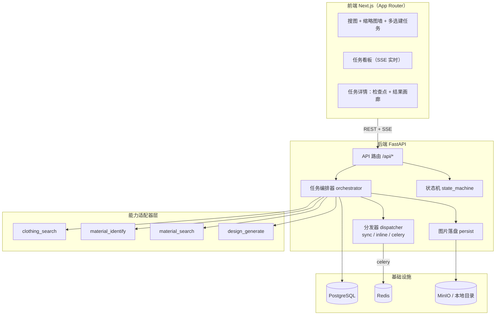
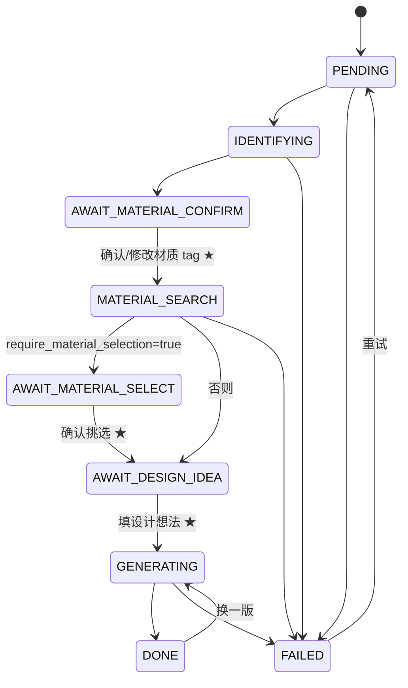

# AI 服装辅助设计（Mock-first MVP）

一条「**搜图 → 选图建任务 → 视觉识别 → 素材检索 → 图生图**」的多阶段 AI 流水线，辅助服装设计工作。

本仓库是**可运行的 MVP Demo**：四个 AI 能力全部以 Mock 实现（确定性占位图 + 假数据），
零外部依赖即可跑通全链路；真实 API 通过替换**适配器**接入，架构与前端无需改动。

---

## 1. 四个能力（abilities）

| 能力 | 签名 | 当前实现 |
|---|---|---|
| 搜索服装图 | `searchClothingImages :: [网站列表] -> [服装图片列表]` | `MockClothingSearchProvider` / `UnsplashClothingSearchProvider` |
| 识别服装材质 | `identifyClothingMaterial :: 服装图片 -> [材质tag列表]` | `MockMaterialIdentifier` / `OpenAICompatibleVLMIdentifier` |
| 查找材质图 | `searchMaterialImages :: [材质tag列表] -> [材质图片列表]` | `MockMaterialImageSearchProvider` / `UnsplashMaterialSearchProvider` |
| 图生图生成设计图 | `generateDesignImage :: ([材质图片], 设计想法) -> [设计图]` | `MockDesignGenerator` / `OpenAICompatibleImageGenerator` |

四个能力的契约定义在 `backend/app/abilities/base.py`，Mock 与真实实现**签名一致、可热插拔**。

---

## 2. 架构



**任务驱动**：每张被选中的服装图 = 一个任务（`Task`），N 张图并发执行 N 条流水线，互不阻塞。

---

## 3. 流水线与人工检查点



三个**人工检查点**是产品成败关键（设计方案 §3）：材质识别错误会导致后续全错，
用户花 3 秒确认 tag 可大幅提升最终满意度。检查点 1 支持**改 tag 重跑后续步骤**。

---

## 4. 目录结构

```
cloth-image/
├─ docker-compose.yml          # postgres / redis / minio / backend / worker / frontend
├─ .env.example                # 全部环境变量与默认值
├─ AI服装辅助设计方案.md         # 原始设计方案
├─ backend/
│  ├─ pyproject.toml
│  ├─ alembic/                 # 数据库迁移（含初始表结构）
│  └─ app/
│     ├─ main.py               # FastAPI 入口（CORS / 路由 / lifespan）
│     ├─ config.py             # pydantic-settings 配置
│     ├─ enums.py              # TaskStatus / TagSource
│     ├─ schemas.py            # API 契约（与前端 types.ts 对应）
│     ├─ storage.py            # 对象存储抽象：local | s3(MinIO)
│     ├─ db/                   # SQLAlchemy 模型与会话
│     ├─ ability_config.py     # ★ 能力配置（设置页写入，DB 为唯一来源，不读 env）
│     ├─ abilities/            # ★ 能力适配器层
│     │  ├─ base.py            #   4 个 Protocol + DTO
│     │  ├─ http.py            #   共享 HTTP 客户端（超时 / 重试 / 具名异常）
│     │  ├─ image_ops.py       #   缩放、缩略图、data URL 编码
│     │  ├─ mock_images.py     #   Pillow 确定性占位图
│     │  ├─ prompting.py       #   图生图 prompt 组装
│     │  ├─ registry.py        #   按能力注入实现（混合 mock / 真实）
│     │  ├─ unsplash_client.py #   Unsplash 共享客户端（鉴权 / 分页 / 归一化）
│     │  ├─ clothing_search/{mock.py, unsplash.py}
│     │  ├─ material_identify/{mock.py, openai_compatible_vlm.py}
│     │  ├─ material_search/{mock.py, unsplash.py}
│     │  └─ design_generate/{mock.py, openai_compatible_image.py}
│     ├─ taxonomy/materials.yaml  # 受控材质词表（60 条，中英双语）
│     ├─ tasks/                # 状态机 / 编排器 / 分发器 / worker / 持久化 / 序列化 / fetch(下载+镜像)
│     ├─ tools/probe.py        # 真实 provider 联调探针
│     └─ api/                  # search / tasks / events(SSE) / taxonomy / media
│  └─ tests/                   # 能力契约 / 状态机 / 端到端 / 适配器 / 图片工具 / 镜像
└─ frontend/
   └─ src/
      ├─ app/page.tsx          # 搜图 + 缩略图墙 + 多选建任务
      ├─ app/tasks/page.tsx    # 任务看板（SSE）
      ├─ app/tasks/[id]/page.tsx  # 任务详情（检查点 + 结果画廊）
      ├─ components/           # Pipeline / SelectableImageGrid / TagEditor / ResultGallery
      └─ lib/                  # api / types / hooks / taskStatus
```

---

## 5. 快速开始

### 方式 A：Docker Compose（推荐，含 Postgres / Redis / MinIO）

```bash
cp .env.example .env
docker compose up --build
```

- 前端 http://localhost:3000
- 后端 API 文档 http://localhost:8000/docs
- MinIO 控制台 http://localhost:9001 （minioadmin / minioadmin）

该模式下 `TASK_EXECUTION=celery`，任务由独立 `worker` 容器消费。

### 方式 B：本机直跑（零依赖，SQLite + 本地文件存储）

后端：

```bash
cd backend
python -m venv .venv
.venv\Scripts\activate          # Windows（macOS/Linux: source .venv/bin/activate）
pip install -e ".[dev]"
uvicorn app.main:app --reload --port 8000
```

前端：

```bash
cd frontend
npm install
$env:NEXT_PUBLIC_API_BASE_URL="http://localhost:8000"   # Windows PowerShell
npm run dev
```

访问 http://localhost:3000 。该模式默认 `STORAGE_BACKEND=local`、`TASK_EXECUTION=inline`（线程池后台执行）。

---

## 6. 配置

**能力配置**（provider / 端点 / Key / 模型）只在**设置页**配置，写入数据库、立即生效，
**不读环境变量**。其余配置见 `.env.example`：

| 变量 | 默认 | 说明 |
|---|---|---|
| `IMAGE_SIZE` | `1024x1024` | 生图尺寸；**必须用 `x` 分隔**，写成 `1024*1024` 会被 API 拒绝 |
| `IMAGE_MAX_REFS` | `3` | 参考图上限；实测 `qwen-image-3.0` 只支持 0~3 张 |
| `PROMPT_EXTEND` | `false` | 是否允许模型改写提示词（已结构化组装，建议关闭） |
| `IDENTIFY_CACHE_ENABLED` | `true` | 相同图片 + 相同模型时复用识别结果 |
| `PROVIDER_TIMEOUT_S` | `90` | 外部调用超时（秒） |
| `PROVIDER_MAX_RETRIES` | `3` | 外部调用失败重试次数 |
| `VISION_MAX_IMAGE_SIDE` | `1568` | 送模型前图片等比缩放的最长边 |
| `TASK_EXECUTION` | `inline` | `sync` 同步（测试）/ `inline` 线程池 / `celery` 队列 |
| `STORAGE_BACKEND` | `local` | `local` 本地目录 + `/media` / `s3` MinIO |
| `DATABASE_URL` | sqlite | 本机 SQLite；Compose 内为 Postgres |

> 上表中的项可由环境变量提供默认值、也可在设置页覆盖；**能力配置项则完全来自设置页**。

### 6.1 在界面上配置（推荐）

打开 `http://localhost:3000/settings`：

- **四个能力**各自显式选择实现，且仅当选中真实实现时才展开配置项：
  - 搜索服装图：`mock` / `unsplash`（Unsplash 图库检索，只需 Access Key）
  - 查找材质图：`mock` / `unsplash`（Unsplash 面料特写，每个材质 tag 一次请求）
  - 识别：`mock` / `openai_compatible`（OpenAI 兼容 `/chat/completions`）
  - 生图：`mock` / `openai_compatible_image`（OpenAI 兼容 `/images/generations`）
- 调整生图参数、识别参数、流水线参数与 HTTP 超时/重试
- 查看识别缓存的命中数与估算省下的 token，并可一键清空

**配置优先级**：能力配置 = 设置页（数据库 `app_setting`）**唯一来源**；
其余项 = 设置页 > 环境变量 / `.env` > 代码默认值。
「重置为环境变量」会清空全部覆盖。

> ⚠️ 密钥**永不回传**（只返回“是否已配置”），但本服务当前没有鉴权 ——
> 能访问该页的人都可以修改配置并**写入**密钥。仅限本机 / 内网使用；
> 对外暴露前请设 `SETTINGS_WRITE_ENABLED=false`（只读查看）或先补上鉴权。

### 6.2 常见问题

- **界面报 `Failed to fetch`**：多半是后端没起来或请求打在了代理上。
  `fetch` 只有在**连接层失败**或**响应缺 CORS 头**时才报这个（而不是 500）。
  先看后端终端有没有 traceback；本机验证用 `curl.exe -s --noproxy "*" http://127.0.0.1:8000/api/health`。
- **后端日志 `no such column: clothing_image.image_hash`**：旧版 `.data/app.db` 缺列。
  启动时会自动补齐（`app/db/schema.py`，仅 SQLite）；也可直接删除 `.data/app.db` 重建。

---

## 7. API

| 方法 | 路径 | 说明 |
|---|---|---|
| GET | `/api/health` | 健康检查 + 当前能力提供方 |
| GET | `/api/search/sites` | 可选网站列表 |
| POST | `/api/search/clothing` | 搜索服装图（`sites`, `query`, `count`） |
| POST | `/api/tasks` | 勾选 N 张图 → 创建 N 个任务 |
| GET | `/api/tasks` | 任务列表（看板） |
| GET | `/api/tasks/{id}` | 任务详情 |
| POST | `/api/tasks/{id}/confirm-materials` | ★检查点1：确认/修改材质 tag → 触发材质检索 |
| POST | `/api/tasks/{id}/select-materials` | ★检查点2：挑选材质图 |
| POST | `/api/tasks/{id}/generate` | ★检查点3：填设计想法 → 生成设计图 |
| POST | `/api/tasks/{id}/retry` | 失败重试 |
| DELETE | `/api/tasks/{id}` | 删除任务 |
| GET | `/api/tasks/{id}/events` | **SSE** 任务进度流（`snapshot` / `event`） |
| GET | `/api/events/stream` | **SSE** 看板任务列表流 |
| GET | `/api/material-taxonomy` | 受控材质词表 |
| GET | `/api/cache/identify/stats` | 识别缓存规模 / 累计命中 / 估算省下的 token |
| DELETE | `/api/cache/identify` | 清空识别缓存（可选 `?model=` 只清某个模型） |
| GET | `/api/settings` | 能力配置：字段清单 + 取值 + 密钥状态 + 能力可用状态 |
| PUT | `/api/settings` | 部分更新配置（`{"values": {...}}`；值为 `null` 表示删除覆盖） |
| DELETE | `/api/settings` | 清空全部覆盖，回退到环境变量 / 默认值 |

### 7.1 识别结果缓存

同一张图 + 同一个模型 → 直接复用上次的识别结果，跳过 VLM 调用。
实测单次识别约 **1500 tokens**，而「同一张图建多个任务」是常见操作，收益直接。

- 缓存 key = `(图片内容 sha256[:32], 模型名)`；**模型名参与 key**，换模型后旧缓存自然失效
- 图片哈希在落盘时顺带算出，存在 `clothing_image.image_hash`
- 命中时会在任务事件里写明「命中识别缓存…省约 N tokens」，前端执行日志可见
- 外链图未下载时算不出哈希，此时不缓存（不影响功能）
- 缓存内容损坏会自动丢弃并重新识别

---

## 8. 测试

```bash
cd backend
.venv\Scripts\python.exe -m pytest -q
```

覆盖：能力契约（Protocol 一致 + 确定性）、状态机转移、端到端流水线
（含人工检查点、自动串联生成、非法操作 409、图片经 `/media` 可访问）。

---

## 9. 接入真实 API

### 9.1 按能力切换（重要）

能力**必须显式配置**：没有全局开关，也没有「留空回退」。在界面上的「能力配置」页
（推荐，立即生效且持久化）逐项选择实现即可；provider 名写错会在**构造能力时立即报错**，
启动日志还会提示端点 / Key / 模型是否缺失。

- 搜索服装图：`mock` / `unsplash`（只需 Unsplash Access Key）
- 识别：`mock` / `openai_compatible`
- 生图：`mock` / `openai_compatible_image`
- 查找材质图：`mock` / `unsplash`（可与服装图共用同一个 Access Key）

> 环境变量**不再**参与能力配置（这是刻意去掉的兼容层）。

### 9.2 已验证示例：阿里云 MaaS（OpenAI 兼容）

这是一种已验证的 OpenAI 兼容端点：同一个 base_url + 同一个 Key 同时提供视觉理解与生图能力。
在各能力的设置里**分别**填入即可（两个能力并不共享配置）。

| 能力 | 端点 | 模型 |
|---|---|---|
| 材质识别 | `POST {base}/chat/completions` | `qwen3-vl-plus` |
| 设计图生成 | `POST {base}/images/generations` | `qwen-image-3.0` |

已实测确认的行为，实现时已按此适配：

- 视觉输入用 OpenAI 标准多模态数组，`response_format={"type":"json_object"}` 可用
  （若目标端点不支持，会自动剥掉该字段重试一次）
- 生图 `size` 必须形如 `1024x1024`，用 `*` 会 400
- 生图 `image` 可传字符串或数组（多参考图），但模型限 **0~3 张**；
  超过会报 `supports 0~3 image content items`
- 生图响应 `data` 是**被转义的 JSON 字符串数组**，需逐个 `json.loads`
- 生图返回的是 **OSS 临时地址** → 编排器会下载并**镜像到自有存储**
- 外部服务**访问不到**我们的 `localhost/media` 地址 → 送模型一律用 base64 data URL

### 9.3 已验证示例：Unsplash（服装图搜索）

只需 **Access Key**（`Authorization: Client-ID <key>`）；Secret Key 仅用于 OAuth，用不到。

- 端点：`GET https://api.unsplash.com/search/photos?query=...&per_page=30&page=1`
- 返回 `results[].urls.{regular,small}`（**官方要求热链**）+ `links.html` + `user.name`，
  我们把摄影师与 Unsplash 署名写进 `title`、原图页存进 `page_url`；图片仍由编排器镜像落盘
- 单页最多 30 条，超出会自动翻页（搜索页 `count` 上限 60）
- **不支持按站点过滤**，`sites` 被忽略；搜索页站点列表会随 provider 变为「Unsplash（不限站点）」
- demo 应用限 **50 次/小时**（响应头 `X-Ratelimit-Remaining`）；超限抛 `ProviderRateLimitError`，
  接口以 **502** 返回可读原因
- **两个能力共用**同一份客户端（`abilities/unsplash_client.py`）与同一个 Access Key：
  服装图按关键词直接搜；材质图把每个材质 tag 转成 `{material_en} fabric texture close up`
  各搜一次（词表里没有英文名时回退 `taxonomy.build_material_query`）
- 材质图的 `similarity` 是**排名代理**（Unsplash 不返回相关性分数），仅用于排序展示
- 提示：Unsplash 以英文关键词效果最佳，中文词命中率有限

### 9.4 联调探针

```bash
cd backend
python -m app.tools.probe                  # 识别 + 生图各跑一次（真实调用，消耗额度）
python -m app.tools.probe --skip-image     # 只探识别
```

会打印生效的 provider、识别出的 tag 与依据、token 用量、生图返回的 URL。

### 9.5 新增一个 provider

四个能力目前都已有 mock + 真实实现。要再接一家：

1. 在 `abilities/<能力>/` 下加适配器类（实现对应 Protocol）；
2. `settings_spec.py` 的 `ABILITY_SPECS` 把该能力的 `options` 加上新 provider 名、
   `fields` 补上需要的配置项（`real_implemented=True` 时 UI 会自动展开）；
3. `abilities/ability_config.py` 加上对应字段（形如 `{ability}_api_key`）；
4. `abilities/registry.py` 的 builder 里加分支。

UI、校验与告警（`config_warnings`）都会自动跟随 spec，无需改前端。

**各能力推荐路线**（详见 `AI服装辅助设计方案.md`）：

- **材质图检索**：MVP 复用图库搜索（query 换成 `"{材质} fabric texture close-up"`）；
  生产自建面料图库 + CLIP/SigLIP embedding + 向量库（pgvector / Qdrant）
- **识别进阶**：先用服装分割（SCHP）裁掉背景再送模型，提升街拍图准确率
- **生成进阶**：多模型对比（`qwen-image-3.0` vs `-pro`）、编辑链迭代

---

## 10. 风险与注意事项

1. **版权合规**：爬取他人服装图作为生成输入，商用有风险。优先授权图库、只存引用 URL、
   生成结果标注来源、定位为「内部设计参考」。
2. **反爬**：能用 API 就别爬；爬虫方案需代理池与验证码处理。
3. **成本**：VLM 识别约 $0.001–0.01/张，图生图约 $0.02–0.08/张，单任务全链路约 $0.05–0.15。
4. **识别准确率**：光泽类材质（真丝 vs 醋酸 vs 缎面涤纶）单图难区分，
   「可能度分析 + 人工确认」是必要设计，不追求全自动 100% 准确。
5. **配置页无鉴权**：`/api/settings` 可以写入密钥。仅限本机 / 内网使用；
   对外部署前必须补鉴权或设 `SETTINGS_WRITE_ENABLED=false`。
6. **密钥不要写进 `.env.example`**：该文件**不在** `.gitignore` 里，会被提交；
   真实密钥只写在本地 `.env`（已忽略）。

---

## 11. 后续可做

- 自建材质图向量库（一次性覆盖常用材质，零外部 API 成本）
- 多模型对比生成（同一任务并行多个生成模型）
- 编辑链迭代（以某张结果图为新输入继续生成，Kontext 系列 ID 保持能力更优）
- 成本核算与预估（当前只有 token 用量事件；API 不返回金额，需按单价自算）
- 用户体系与任务配额
